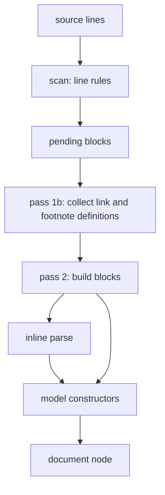
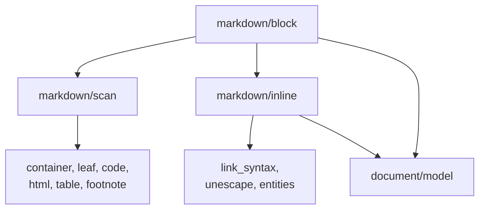

# Architecture: Markdown frontend

## What

The Markdown frontend turns source lines into a `document.model` tree
(`doc/document-model.md`). `markdown.block.parse(lines) -> document` is the
entry point. It is a pure function and touches no buffer or window.

## Scope

- In: `lua/doc_preview/markdown/` and the `document/model.lua` constructors
  it calls. Syntax rules are in `doc/architecture.md` 4.2 and 6.1.
- Out: rendering (`doc/architecture-renderer.md`). Diagram source is only
  passed through as `code_block{lang}`.
- RST: there is no `rst/` parser yet. `doc/architecture.md` 6.2 describes
  the planned subset, and only Markdown and Mermaid files have a frontend.

## Behavior

### Pipeline

1. **Scan** (`scan.lua`): each line is probed once, and the first rule
   that matches consumes one or more lines. The rules are tried in this
   order: blank, indented code, fence, footnote, HTML, table, ATX heading,
   setext underline, rule, quote, list item, text. The result is a list of
   pending blocks. Each one records its source range and either raw text or
   children.
2. **Definitions** (`block.lua`, pass 1b): link reference definitions are
   taken from the start of paragraphs, and footnote labels are recorded. This
   happens before any inline parsing, so a reference may come before its
   definition.
3. **Build** (`block.lua`, pass 2): each pending block becomes a model node.
   Paragraphs, headings and table cells are parsed by `inline.lua`. A
   paragraph whose only inline is an image becomes an `image` block.

### Components

| Module | Role |
|---|---|
| `block` | Entry point. Runs scan, pass 1b and pass 2, and wires `container.setup` |
| `scan` | Rule table from lines to pending blocks. `linenos[k]` maps a scanned line to its source line, and `lazy[k]` marks a lazy continuation line |
| `container` | Block quotes and list items. It strips the prefix and rescans the inner lines with the same `scan`, keeping the line map. `scan` and the classifiers are injected through `setup()` to avoid a require cycle |
| `leaf`, `code`, `html`, `table`, `footnote` | Line classifiers and `take_*` collectors for each block kind |
| `inline` | Turns text into inline nodes: code spans, escapes, entities, emphasis (delimiter stack), links, images, autolinks, raw HTML, breaks and footnote refs |
| `link_syntax`, `unescape`, `entities` | Pure string helpers for labels, destinations, titles, definitions and character references |

### Invariants

- Every block node has `src_start`/`src_end` in real source lines, including
  blocks nested in quotes and list items, because of the line map. Code and
  HTML blocks also carry `src_body`. The source map depends on these ranges
  (`doc/architecture-renderer.md`).
- The parser only emits kinds that are registered in `document/model.lua`.
  Raw HTML uses the kinds `html_block` and `html_inline` (without the `md:`
  prefix that `doc/document-model.md` lists).
- The parser never raises on any input. Text that matches no construct stays
  a paragraph or literal text.
