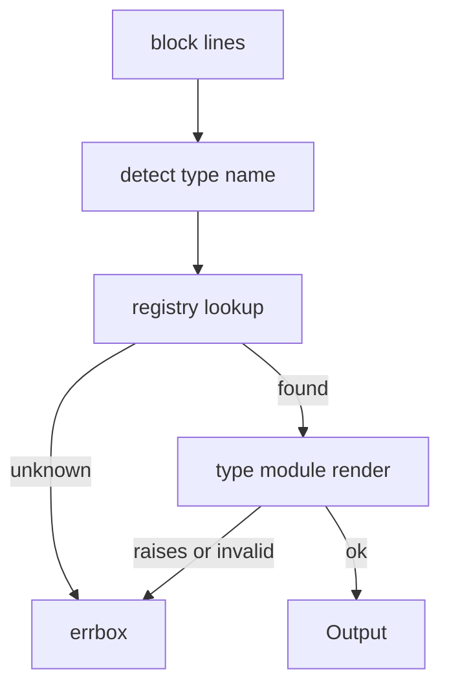
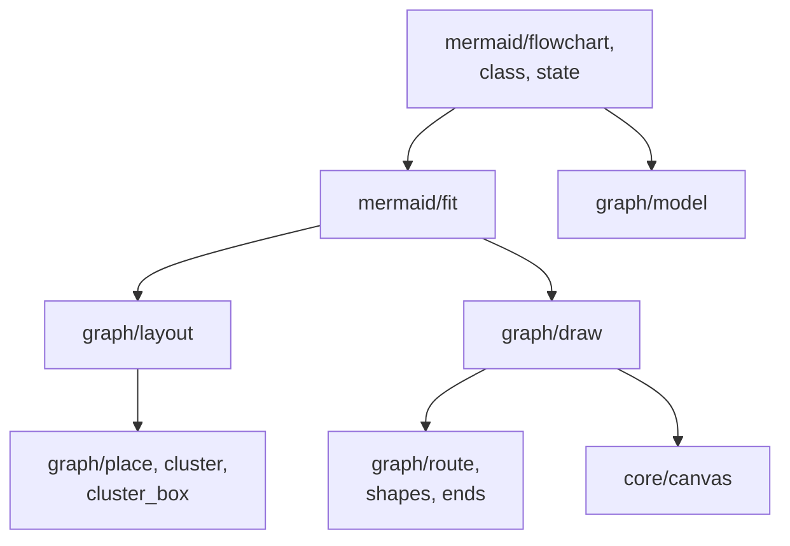
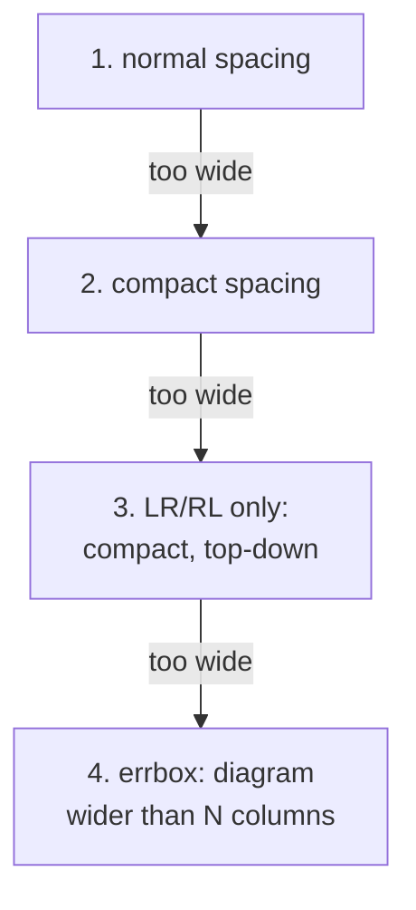
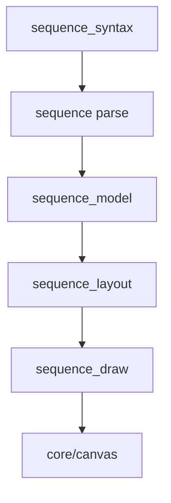

# Architecture: Mermaid engine and graph kit

## What

`mermaid.render(lines, ctx) -> Output` draws a Mermaid diagram as text. Type
modules parse the source to a `graph.model` and draw it with the shared
`graph/` kit, except sequence diagrams, which have their own model, layout and
drawing. Glyph tables and per-type decisions are in `doc/diagram-model.md` 1
and `doc/architecture.md` 10 item 1.

## Scope

- In: `lua/doc_preview/mermaid/` and `lua/doc_preview/graph/`.
- Implemented types: flowchart/graph, sequence, class, state. ER only
  parses: its `render` raises "drawing not implemented yet", so an ER diagram
  is shown as an errbox.
- Out: `dot/`, `d2/` and `plantuml/` do not exist yet. Document flow,
  `safe()` and the source map are covered in `doc/architecture-renderer.md`.
- Engines depend only on `core/` and `graph/`. They know nothing about
  Markdown or `document/`.

## Behavior

### Dispatch (`mermaid/init.lua`, `registry.lua`, `source.lua`)

- `source.first_content` skips blank lines, `---` frontmatter, `%%` comments
  and `%%{...}%%` directives. The first word of the next line is the type
  name, and it is case-sensitive.
- `registry` maps a type name to a module that has `render(lines, ctx)`. Both
  `flowchart` and `graph` are registered, and the `-v2` aliases are
  registered for class and state.
- `render` always returns an Output. Every failure is turned into
  `core/errbox` with a `mermaid: <reason>` title. The result is checked with
  `out.valid(result, ctx.width)`.

### Graph-based types

`mermaid/er` builds a `graph.model` too, but it does not call `fit` yet.

| Module | Role |
|---|---|
| `graph/model` | `{direction, nodes, edges, subgraphs}`. Nodes have `shape` and optional `rows`, which make a record (class, state, ER). Edges have a style, head/tail kinds and end labels. `validate` checks the graph |
| `graph/layout` | Layered layout: back edges reversed, layers assigned, dummies added on long edges, layers ordered by barycenter, coordinates placed (`place`). Returns node and dummy boxes, layers, edge key chains and cluster boxes in character cells |
| `graph/cluster`, `cluster_box` | Subgraphs: pad items keep members together and keep outsiders out, extra border rows go in layer gaps, and one box per cluster |
| `graph/route` | Orthogonal polylines along the layout channels, self loops, label spots and the right margin that loops need |
| `graph/draw` | `fit(g, width)` cuts labels with `...`. `draw(g, lay, ctx)` paints clusters, nodes, edge lines, end markers, titles, end labels and edge labels, in that order, and returns `(Output, natural_width)` |
| `graph/shapes` | Border glyphs for each shape and charset, size, record dividers. An unknown shape is drawn as `rect` |
| `graph/ends` | End decoration glyphs for each kind and direction, and candidate spots for cardinality text |

Each type module (`flowchart`, `class`, `state`, `er`) has a `*_syntax.lua`
with pure token parsers. `parse(lines)` builds the graph, and `render` raises
on an empty graph.

### Width policy (`mermaid/fit.lua`)

- The first attempt that fits is used. Step 1 uses compact spacing when
  `ctx.compact` is set. An attempt fits when the `natural` width from `graph/draw` is at most
  `ctx.width`. The canvas never draws past `ctx.width`.
- Below 5 columns there is no room for an errbox, so the clipped drawing is
  returned.

### Sequence diagrams

- `sequence_model` is the syntax-free `Seq` tree: participants plus events
  (message, note, activation, autonumber, nested blocks with sections).
- `sequence_layout` puts one column per participant and one row group per
  event. Column x positions are the longest-path solution of
  `c[j] >= c[i] + d` constraints.
- `sequence_draw` paints the lifelines, arrows, notes and frames on the
  canvas.
- `sequence.render` has its own width policy. It tries normal spacing, then
  compact spacing, then compact spacing with message and note text wrapped to
  30, 20, 14, 10 and 6 columns, and finally the errbox.

### Slicing

Layout, routing and drawing loops call `core/job.yield_point()`, so a large
diagram does not block input.
