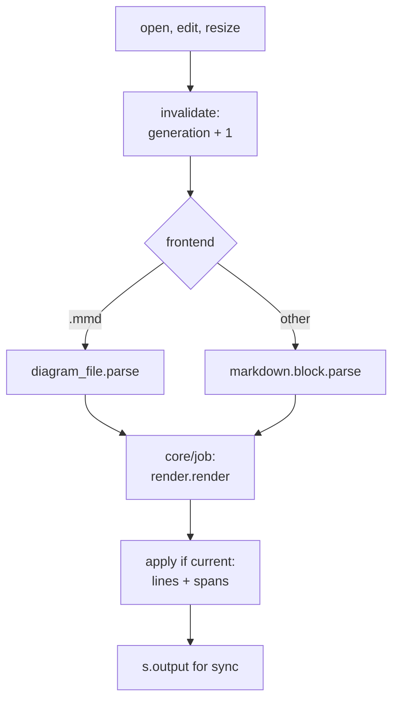
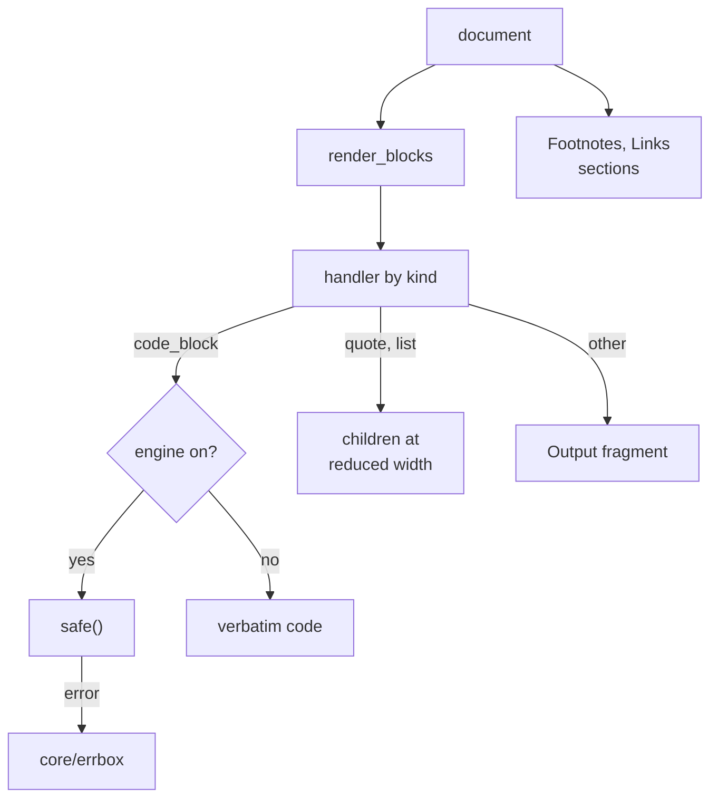

# Architecture: renderer, output and session

## What

`document/render.lua` turns a `document.model` tree into one `Output`
(lines, highlight spans and source map) at `ctx.width`. The session chooses a
frontend for the buffer, runs the render as a sliced job and applies the
result to the preview buffer. The Output contract is in
`doc/architecture.md` 4.1, and sync and layouts are in sections 5 and 5.1.1.

## Scope

- In: `document/render.lua` (plus `table_render`, `linklist`,
  `footnote_render`, `diagram_file`), `core/out`, `core/errbox`,
  `core/canvas`, `core/job`, `session.lua`, and how `sync.lua` uses the map.
- Out: parsers (`doc/architecture-markdown.md`) and diagram internals
  (`doc/architecture-mermaid.md`).
- Not implemented: the block cache and incremental render
  (`doc/architecture.md` 4.4). Every render is a full re-parse and a full
  re-render. `core/codeblock` (treesitter highlighting) does not exist, so
  code is rendered plain.

## Behavior

### Session flow

The `.mmd` edge stands for filetype `mermaid` or a name ending in `.mmd` or
`.mermaid`.

- The frontend is chosen once, when the session opens. `diagram_file` wraps
  the whole buffer in one `code_block{lang="mermaid"}` (lines 1..n). Diagram
  files therefore go through the same renderer, `safe()` and map as fenced
  diagrams.
- `ctx` holds `width` (`min(preview width, max_width)`), `charset` and
  `engines` from the config.
- `core/job` runs the render in a coroutine and resumes it on a 0 ms timer
  once per slice (`slice_ms`). `yield_point()` yields when the slice is used
  up and does nothing outside a job. A result is applied only if its
  generation is still current. The `User DocPreviewRendered` autocmd fires
  after the result is applied.

### Document renderer (`document/render.lua`)

Quote and list children go back through `render_blocks`.

- `handlers` maps `kind` to a function. A missing kind renders
  `[unsupported: kind]`. Blocks are separated by one blank line, and in tight
  lists a paragraph and the list nested under it are joined without one.
  `footnote_def` blocks are removed from the flow.
- Inline text is flattened to a string plus styled byte ranges, then wrapped
  by `core/text.wrap_styled`. A link adds a `[n]` marker from
  `ctx.links` (`linklist`), and a footnote ref adds `[^n]` from
  `ctx.footnotes`.
- Containers render their children with a smaller `ctx.width`, then shift
  the result with `out.prefix` (quotes) or `hang` (list markers). Spans and
  map entries are kept.
- `job.yield_point()` runs before each block and each list item.

### Engine dispatch and `safe()`

- `engines` maps a `lang` to `{render, flag}`. Only `mermaid` exists today.
  When `ctx.engines[flag] == false`, the block is shown as plain code.
- `safe()` calls the engine with a fresh `{width, charset}`. If the engine
  raises, or its result fails `out.valid` (wrong shape or a line wider than
  the width), the block becomes
  `errbox.render(lines, ctx, "<lang>: <message>")`. Other blocks are not
  affected.
- An engine block is atomic. Its map is replaced by one entry over
  `src_start..src_end`, fences included.

### Core kit

| Module | Role |
|---|---|
| `core/out` | Output builder: `add_line`, `add_span` (0-based byte columns, end exclusive), `add_map`, `append` (shifts the line numbers of the appended part), `prefix`. `valid(o, width)` is the check engines must pass |
| `core/errbox` | Boxed, dimmed listing: the title, a divider, then the source hard-wrapped to fit. Below 5 columns it is plain text without a box. One map entry covers the whole source, and it never raises |
| `core/canvas` | 2D cell grid with 0-based coordinates. A wide char takes two cells. Line cells keep a direction mask, so crossings merge into the right junction glyph, in solid, dotted or thick style and in unicode or ascii. Writes past the width are clipped. `to_output()` trims trailing blanks and creates no map |
| `core/job` | Coroutine slicing and cancellation (see above) |

### Source map

- Each handler adds its map entries in fragment-local line numbers, and
  `append`/`prefix` keep them aligned. Paragraphs map their whole range.
  Code and HTML blocks map each source line. Tables map each row. Engine
  blocks map as one entry. Links and Footnotes entries map to the first use
  and to the definition, respectively.
- `Output:src_to_out` and `Output:out_to_src` interpolate linearly inside an
  entry. A line outside every entry snaps to the nearest one.
- `sync.lua` uses the map of the last applied Output, `s.output`, to follow
  the cursor and scroll position in split layouts and for
  the one-time mapping on each flip in `replace` (`replace.lua`).
