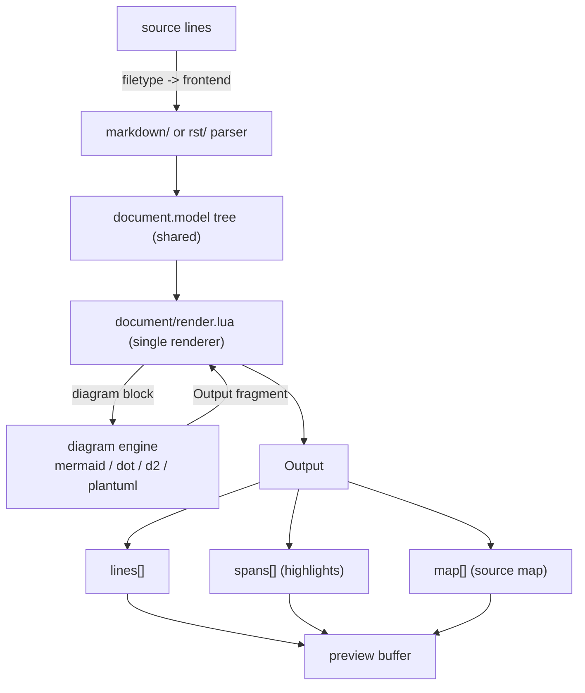

# nvim-doc-preview: architecture

Status: draft v8 (preview window layouts: `vsplit`, `hsplit`, `replace`). Open items at the end.

## 1. Purpose

Neovim plugin that renders Markdown and reStructuredText (with embedded
Mermaid diagrams) into a **read-only preview buffer**, shown either in a split next to
the editing buffer or in place of it in the same window (5.1.1). Content
stays synchronised (debounced); in split layouts cursor/scroll position
is synchronised too (bidirectional).

The output is Unicode text (box-drawing characters, bullets) styled with
extmark highlights. It is called "ASCII" informally; it is not 7-bit.

## 2. Decisions

| Topic | Decision |
|---|---|
| Name | repo `nvim-doc-preview`, Lua namespace `doc_preview`, command `:DocPreview` |
| Neovim | 0.10+; **zero runtime dependencies**: only Neovim itself (stdlib, `vim.uv`, extmarks, treesitter API). Test and oracle tooling may use external dependencies (see `doc/testing.md`) |
| Licence | **MIT**. Only code under MIT-compatible permissive licences is ported (`doc/testing.md` 4.2) |
| Language | Lua only, no external processes |
| Markdown parser | own Lua parser, emits `document.model` |
| RST parser | own Lua parser (supported subset, see 6.2), emits `document.model` |
| Mermaid | own Lua renderer, one module per diagram type |
| Document model | one shared `document.model` tree for md and rst: the **union** of both formats' semantics. Format-specific constructs, and names that would mean different things in the two formats, are namespaced (`rst:field_list`, `md:html_block`); see `doc/document-model.md` |
| Pipeline | per-format block + inline parsers (`markdown/`, `rst/`) -> `document.model` -> **one** renderer (`document/render.lua`) on the `core/` kit and the diagram engines |
| Embedded blocks | no registry layer: the single doc renderer calls the engine directly (`if info == "mermaid" then mermaid.render(...)`). Engines: code highlight (`core/codeblock`), `mermaid/`, `dot/`, `d2/`, `plantuml/`, all in this repo; no user-registered or external handlers |
| Rendering | always async (coroutine-sliced, cancellable) |
| Links | footnote style: text plus `[n]`, URL list at the end of the document |
| Mermaid node shapes | border-glyph variants on fixed-height boxes |
| RST cross-references | not supported (`:ref:`, `:doc:` render as plain styled text) |
| Output | Unicode box-drawing + extmark highlights; inline markup removed at render time (no `conceallevel` in the preview) |
| Preview window | plugin-owned scratch buffer, one preview per source buffer; layout `vsplit` (default), `hsplit` or `replace` (same window, flipped with the source), see 5.1.1 |
| Update trigger | debounced on text change, incremental re-render of changed blocks |
| Width | hard-wrap to `min(window width, max_width)`, re-render on resize |
| Sync | source map, bidirectional cursor/scroll in split layouts; position mapped once per flip in `replace` |
| Sources | `markdown`, `rst` filetypes, plus standalone `.mmd`/`.mermaid` files |
| Elements | headings, paragraphs, inline styles, lists, block quotes, rules, code blocks (syntax highlighted), tables, images (placeholder), admonitions, Mermaid |
| Tests | plenary.nvim (busted-style) as test-only dependency; input->output reference pairs taken from official test suites of existing implementations; headless Neovim for integration tests |
| Reuse | port as much existing code as licensing permits; credit sources in docs and in code |

## 3. Layout

```
nvim-doc-preview/
  plugin/doc_preview.lua        -- defines :DocPreview, no heavy requires
  lua/doc_preview/
    init.lua                    -- setup(opts), public API
    config.lua                  -- defaults, validation
    session.lua                 -- Session: source buf <-> preview buf/win state
    sync.lua                    -- autocmds, debounce, cursor/scroll sync
    core/                       -- shared render kit (format-agnostic)
      text.lua                  -- display-width, wrap, pad (uses vim.fn.strdisplaywidth)
      box.lua                   -- box-drawing primitives, ascii fallback charset
      table.lua                 -- column fitting, cell wrapping, grid layout
      canvas.lua                -- 2D char grid for diagrams (put, line, box, arrow)
      out.lua                   -- Output builder: lines, highlight spans, source map
      highlight.lua             -- highlight group names, extmark application
      codeblock.lua             -- treesitter highlight of code text by language -> Output (plain dimmed if no parser)
      errbox.lua                -- boxed, dimmed source listing / error box (fallback for any failing or unsupported block)
    document/                   -- format-independent document layer
      model.lua                 -- node constructors, kind registry, validation (see `doc/document-model.md`)
      render.lua                -- document.model -> Output (the only document renderer)
    markdown/                   -- parser only; independent of rst/
      block.lua                 -- lines -> document.model blocks (+ md: nodes)
      inline.lua                -- md inline parser (emphasis, links, code spans)
    rst/                        -- parser only; independent of markdown/
      block.lua                 -- lines -> document.model blocks (adornments, directives, tables)
      inline.lua                -- rst inline parser (roles, literals, hyperlinks)
    graph/                      -- shared graph model, layout and drawing
      model.lua                 -- Graph{nodes, edges, subgraphs, direction}
      layout.lua                -- layered layout (place.lua: coordinates; cluster*.lua: subgraphs)
      draw.lua                  -- layout -> canvas (shapes, arrows, labels)
      shapes.lua                -- border-glyph shape table
    mermaid/
      init.lua                  -- render(source, ctx) -> Output
      registry.lua              -- diagram type -> module
      flowchart.lua             -- parse -> graph.model
      sequence.lua              -- parse (sequence_syntax/_model) + width policy
      sequence_layout.lua       -- Seq -> columns, rows, frames (syntax free, shared with plantuml)
      sequence_draw.lua         -- layout -> canvas -> Output
      class.lua state.lua er.lua gantt.lua pie.lua   -- see `doc/diagram-model.md`
    dot/
      parse.lua                 -- dot subset -> graph.model
    d2/
      parse.lua                 -- D2 subset -> graph.model
    plantuml/
      init.lua                  -- render(source, ctx) -> Output
      registry.lua              -- diagram type -> module
      sequence.lua class.lua    -- reuse graph/ or mermaid/sequence drawing where models match
      activity.lua state.lua usecase.lua component.lua object.lua   -- see `doc/diagram-model.md`
      gantt.lua mindmap.lua     -- see `doc/diagram-model.md`
  doc/                          -- design docs (this folder)
  tests/
    minimal_init.lua            -- headless test init: adds plugin + plenary to rtp
    unit/                       -- pure-Lua specs (parsers, layout, core)
    pairs/{md,rst,mermaid,dot,plantuml,d2}/   -- reference input->expected pairs (from tool test suites)
    golden/{md,rst,mermaid,...}/              -- hand-reviewed rendered-output goldens
    integration/                -- headless Neovim specs (session, sync, async)
  tools/oracle/                 -- fixture generators that run the reference tools (see `doc/testing.md`)
  LICENSE                       -- MIT
  NOTICE                        -- credits for all ported code and test data
  doc/references.md             -- per-reference: version, licence, what was ported/used
```

Dependency rules:

* `core/` depends on nothing in the plugin.
* `document/` depends on `core/` and on the diagram engines
  (`mermaid/`, `dot/`, `d2/`, `plantuml/`); it knows no concrete format.
* `markdown/` and `rst/` depend only on `document/model.lua` and, for
  `core.job.yield_point()` in long parse loops (a no-op outside a job),
  `core/`; never on each
  other or on the renderer. Block and inline *syntax* differs, so each
  format keeps its own parser; the *tree* they produce is shared, so
  they can be developed and tested in isolation (parser -> model
  assertions) while rendering is written once.
* `mermaid/`, `dot/`, `d2/` and `plantuml/` are diagram *languages*: they parse to
  `graph.model` (or, for sequence, their own model) and share `graph/`
  for layout and drawing. They depend on `core/` and `graph/` only and know nothing about Markdown, RST or `document/`.

## 4. Pipeline



### 4.1 Output (the contract between renderers and the session)

Every renderer returns the same structure, built through `core/out.lua`:

```lua
---@class doc_preview.Output
---@field lines string[]            -- rendered text, one entry per preview line
---@field spans doc_preview.Span[]  -- {line, col_start, col_end, hl_group}
---@field map   doc_preview.MapEntry[]
---@field links doc_preview.Link[]  -- optional: {line, col_start, col_end, target}

---@class doc_preview.MapEntry
---@field out_start integer  -- first preview line (1-based) of the block
---@field out_end   integer
---@field src_start integer  -- source line range the block came from
---@field src_end   integer
```

Blocks (not lines) are the map granularity. Inside a block, lines are
mapped by linear interpolation for wrapped paragraphs; atomic blocks
(tables, diagrams, code) map to their whole source range, optionally
refined per row (code and HTML blocks map 1:1: each rendered row of a code line maps to that line's source line, so rows of a hard-wrapped long line share it; table rows map to their source row: header rows to the header line, the delimiter border to the delimiter line, body rows to their line (wrapped rows share it), the top border to the header, the bottom border to the last row; border rows never stay unmapped). Linear interpolation applies to paragraphs only.

Footnotes section (0016): each section entry maps to its definition's source
range (the text shown there), not to the first-use line; the in-text marker
maps through its paragraph. The numbering registry still records the
first-use line, but the renderer does not use it for the section map. This
differs from the Links section, whose entries map to the first-use line.

### 4.2 Parsers

* Two-stage, like most Markdown/RST parsers: block structure first, then
  inline parsing inside leaf blocks.
* Every block node carries `src_start`/`src_end` (source line range).
  This is mandatory; the source map depends on it.
* Parsers are pure functions `string[] -> document.model`, no Neovim API calls, so
  they can be tested outside Neovim.
* Parsers normalise format quirks while parsing, so the renderer never
  sees them: Markdown link reference definitions are resolved into link
  targets (the block pass collects definitions from the start of paragraphs
  before any inline text is parsed, so a definition may follow its use); RST adornment styles are mapped to heading levels by order of
  first appearance; setext/ATX both become `heading{level}`.
* Markdown containers (block quotes) are parsed by scanning the marker-stripped
  inner lines with the same line scanner (recursion handles nesting), with a
  map from inner lines to source lines so every child keeps real
  `src_start`/`src_end`. A marker-less non-blank line continues the quote
  only lazily, when the last inner block is an open paragraph and the line
  starts no other block; a blank line ends the quote.
* List items use the same machinery (`markdown/container.lua`): an item
  starts with a bullet or 1-9 digits plus `.`/`)` and 1-4 spaces (content
  column), and a following line belongs to it when indented at least to the
  content column (or lazily, as for quotes). A different bullet char or
  delimiter starts a new list; an ordered list interrupts a paragraph only
  at 1, an empty item never does. A list is loose when blank lines separate
  its items or two direct children of one item, else tight (`list.tight`).
* Code (`markdown/code.lua`): a fence opens with 3+ backticks or tildes at
  0-3 columns of indent (a backtick info string may not contain a backtick),
  closes on a line of the same char, at least as long, 0-3 indent and only
  trailing blanks, strips up to the opener's indent from its lines, and runs to
  the end of the scanned lines (document or container) when unclosed. Lines
  inside a fence are raw: no other block rule applies. A fence interrupts a
  paragraph. Indented code is 4+ columns (tab stop 4) after a blank line or at
  block start, never a paragraph continuation; interior blank lines are kept,
  trailing ones dropped. Code is never lazily continued, and an unindented
  fence opener ends a quote or item instead of continuing it.

### 4.3 Renderers

* One pure function `(document.model, ctx) -> Output` for all formats, where `ctx` carries `width`,
  charset (unicode/ascii fallback) and theme options.
* Inline markup (`**bold**`, `` `code` ``, links, emphasis) is consumed at
  render time: markers are dropped, spans are emitted. Links render as
  text plus a footnote marker `[n]`; targets are collected in a
  "Links" list appended at the end of the document (numbered in order of
  first appearance, duplicates share a number; same `target` means same
  number, the title is ignored). Each Links entry maps to the source line of
  the block holding its first use. Link numbers and footnote numbers are
  **separate sequences** (links `[n]`, footnotes `[^n]`, decided in 0007),
  so adding footnotes never renumbers links. The numbering lives in
  `document/linklist.lua`, one registry per render (`ctx.links`).
* Footnotes (0016): `footnote_ref` renders as `[^n]` (`DocPreviewFootnoteRef`),
  n in order of first use, duplicates share a number, separate from link
  numbers (`document/footnotes.lua`, `ctx.footnotes`). Definitions are not
  rendered in place. A "Footnotes" section (`DocPreviewH2`, entries `n. `
  plus the body blocks with a hanging indent, `document/footnote_render.lua`)
  follows the body and precedes the Links section; unreferenced definitions
  are omitted, links inside bodies are numbered after those in the body.
* Images render as `[image: alt text]` placeholders; an empty alt gives
  `[image]`. Newlines in alt count as spaces, `src` and `title` are never
  shown. The whole placeholder carries `DocPreviewImage` (-> `Comment`). Inline
  images are part of the surrounding text and wrap with it (paragraphs,
  headings, table cells; inside a link the underline and `[n]` marker stay,
  the image group sits on top). A block image is wrapped at `ctx.width`, the
  group is on every row, and one map entry covers all its rows.

### 4.4 Block-level cache and incremental render

The `document.model` top-level children are cached with a content hash of their source
range. On a change:

1. Re-parse (cheap; parsers are linear).
2. Diff top-level blocks by hash; reuse cached `Output` fragments for
   unchanged blocks at the same width.
3. Re-render only changed blocks (Mermaid blocks are the expensive case,
   which is the point of the cache).
4. Concatenate fragments, rebuild the source map, replace only the
   changed line range in the preview buffer.

Re-parse is whole-document in v1. Incremental parsing is out of scope.
Width change invalidates all cached fragments.

### 4.5 Embedded blocks

Note: until `core/codeblock` exists (0012 only), every `lang` except an engine renders as plain code. Implemented so far: `mermaid` only. `engines` in `render.lua` maps `lang` to `{render, flag}`; `ctx.engines` (from `config.options.engines`, set by the session) switches an engine off (`engines.mermaid = false` shows the block as plain code). `safe()` shares `core/out.valid` with `mermaid/init.lua`. The block's map is one entry over `src_start`..`src_end` (fences included), already document-relative, also in quotes and list items (reduced `ctx.width`).

There is no dispatch layer. Both parsers turn code-like source (Markdown
fenced block; RST `code-block`/`mermaid`/`dot`/... directive or literal
block with a language) into a `code_block{lang, lines}` node, and the
single renderer decides what to do, in `document/render.lua`:

```lua
local engines = {            -- one table, shared by all formats
  mermaid = mermaid.render,
  dot = dot.render, graphviz = dot.render,
  d2 = d2.render,
  plantuml = plantuml.render, puml = plantuml.render,
}
local render = engines[node.lang]
local out = render and safe(render, node.lines, ctx)       -- engines: lines, ctx -> Output
         or codeblock.render(node.lines, node.lang, ctx)   -- unknown name: highlight or plain
```

* Every engine has the same signature `render(lines, ctx) -> Output`
  (ctx has width, charset). Engines do not know which frontend called
  them, nor which format the document is in; the renderer wraps the result into the document flow and rebases
  the source map.
* `safe()` is a `pcall` wrapper: an engine that errors or returns an
  invalid Output is replaced by `core/errbox`.
* The small name->engine table is intentionally duplicated per frontend:
  the frontends stay independent, and the RST table also keys on
  directive names (`.. mermaid::`, `.. code-block:: python`).
* Unknown names (`python`, `lua`, ...) go to `core/codeblock`, which
  highlights through treesitter if a parser is installed and otherwise
  shows plain dimmed text.
* Supporting another language means writing an engine module here and
  adding one line to each frontend's table; no user-facing registration
  or external-process engines.

## 5. Session and synchronisation

### 5.1 Session

One `Session` per source buffer:

```
Session { src_buf, src_win?, prev_buf, prev_win, layout, src_view?, frontend, width,
          cache, output, timer, augroup }
```

* `:DocPreview open` creates a scratch buffer (`buftype=nofile`,
  `bufhidden=wipe`, `modifiable=false`, `swapfile=false`), shows it
  according to the layout (5.1.1), attaches autocmds.
* A session exists exactly while its preview is shown: closing the
  preview window (split layouts), the preview buffer, or flipping back
  to the source (`replace`) tears it down, including timer, running job,
  augroup and cache. Closing the source buffer closes the preview.
* Commands run from either the source or the preview buffer resolve to
  the same session.
* Preview buffer content is written with `modifiable` toggled by the
  plugin only.

### 5.1.1 Layout

Config key `layout` (8), overridable per command (5.2):

| Layout | Display | Window ownership |
|---|---|---|
| `vsplit` (default) | vertical split, preview right of the source | plugin owns the preview window |
| `hsplit` | horizontal split, preview below the source | plugin owns the preview window |
| `replace` | preview buffer replaces the source buffer in the current window; no extra window | user owns the window; plugin owns only the preview buffer |

* Split sides are fixed (right, below); there is no separate side
  option (`layout` supersedes `split = right|left|below|above`).
* The over-the-buffer layout is named `replace`, not `toggle`, because
  `toggle` is already a subcommand: `:DocPreview toggle toggle` would
  be ambiguous to read and to complete.
* Validation: `setup()` rejects any `layout` other than the three names
  with an error naming the key and the allowed values; an invalid
  command argument reports an error and opens nothing.
* `replace` mode:
  * Opening saves the source window view (`winsaveview`) in the
    session and shows the preview buffer in that window; the preview
    cursor/topline are placed at the line mapped from the source cursor
    (5.4 lookup, once), keeping the same relative screen row.
  * Flipping back (`close`, `toggle`, or the `q` map) shows the source
    buffer again in the same window. If the preview cursor was not
    moved, the saved view is restored exactly; otherwise the source
    cursor goes to the line mapped from the preview cursor, same
    relative screen row.
  * The window is never closed by the plugin. If the user closes it or
    shows another buffer in it, the preview buffer is wiped
    (`bufhidden=wipe`) and the session tears down without restoring the
    source view. The source buffer is only hidden while previewed, never
    unloaded; unsaved changes are kept.
    Window-local options are still restored when the window survives
    (another buffer shown); `sync on|off` is a no-op in `replace`.
  * Content sync (5.3) still runs: the source can change while hidden
    (another window, external reload).
  * Window-local options the plugin sets for the preview are restored
    on flip back, since the window is the user's.
* Width (4.3 `ctx.width`) is `min(preview window width, max_width)` in
  every layout; in `replace` that is the shared window, in `hsplit`
  usually the full editor width, so `max_width` is the effective limit.

### 5.2 Commands

```
:DocPreview open [vsplit|hsplit|replace]
:DocPreview toggle [vsplit|hsplit|replace]
:DocPreview close | refresh
:DocPreview sync on|off        -- toggle cursor/scroll following (split layouts)
```

* The optional layout argument overrides `layout` for that session only.
* `open`: no session -> open in the given (or configured) layout. A
  session in the same layout -> no-op. A session in another layout ->
  close it and reopen in the requested one.
* `toggle`: exactly `if session then close else open(layout)`. It closes
  a session opened by `open` in any layout, and the layout argument is
  then ignored. In `replace` this flips the window between source and preview.
* `close`: split layouts close the preview window (never the last
  window) and wipe the buffer; `replace` flips back as in 5.1.1.
* `sync` is a no-op in `replace`.

### 5.3 Content sync

* Autocmds on the source buffer: `TextChanged`, `TextChangedI`,
  `BufEnter` (filetype change via `FileType`).
* Debounce with a `vim.uv` timer (default 150 ms, configurable). Each
  event restarts the timer; render runs in the main loop via
  `vim.schedule`.
* Rendering is **always asynchronous**: the render job is a coroutine
  driven by the `vim.uv` loop. It processes one top-level block at a
  time and yields when a time slice (default 8 ms) is used up; heavy
  engines (graph layout, large tables) must also call a `yield_point()`
  helper from `core/` inside their loops (per layout layer, per edge
  routing pass). The Markdown block scanner yields once per scanned
  line, so a long parse neither freezes the UI nor ignores cancellation.
* Each session has a monotonically increasing `generation`. A new change
  or resize bumps it; a running job notices at its next yield and aborts.
  Results from stale generations are discarded, never applied.
* Cache hits (4.4) return immediately without yielding.
* The preview buffer is updated once per finished job (single
  `nvim_buf_set_lines` over the changed range), or progressively per
  chunk of finished blocks above the first unchanged one; choose the
  single-update variant first. Until a block is rendered, its previous
  fragment (or a dim "rendering..." line for new blocks) stays visible.
* Source-map lookups during a running job use the last completed map.
* No worker threads: everything runs on the main loop (Neovim buffer and
  treesitter APIs are main-thread only), slicing provides responsiveness.

### 5.3.1 Resize

`WinResized` / `VimResized` -> recompute width -> full re-render
(cache invalidated) -> re-sync cursor. A resize that leaves the effective
width unchanged (height only, or beyond `max_width`) is a no-op. The
re-sync runs even when the preview has focus. `WinResized` is filtered
by `v:event.windows` to the preview window. Same in every layout; in
`replace` the watched window is the shared one, and there is no
re-sync step.

### 5.4 Cursor and scroll sync (bidirectional)

Uses the source map from `Output.map`. Applies to `vsplit` and `hsplit`
only. In `replace` the two buffers are never visible together, so no
autocmd-driven sync is attached; the same lookups are used once per
flip (5.1.1).

* **Source -> preview**: on `CursorMoved`/`WinScrolled` in the source
  window, look up the block containing the source line, compute the
  corresponding preview line, set the preview cursor and `topline` so the
  relative window position matches.
* **Preview -> source**: the same in reverse, with the preview window as
  the origin.
* **Loop guard**: sync sets a `session.syncing` flag (or records the
  expected target position) so the programmatic move in the other window
  does not trigger another sync.
* Edge cases: lines with no mapping (block separators) snap to the nearest
  mapped line; positions inside a diagram map to the diagram block start.
* The preview buffer is read-only. There is no jump-to-source map: the UI
  only opens and closes the preview.

## 6. Format frontends

A frontend is a parser from one source syntax to `document.model` (`doc/document-model.md`). It
owns syntax only; layout, wrapping, highlighting and engine dispatch are
the shared renderer's job.

### 6.1 Markdown

Target: CommonMark core plus GFM tables, strikethrough, task lists, and
footnotes (rendered as a footnote section).

Blocks: ATX/setext headings, paragraphs, block quotes, ordered/unordered/
task lists (nested), fenced and indented code, thematic breaks, pipe
tables, HTML blocks (shown verbatim, dimmed), link reference definitions.
Inlines: emphasis, strong, strikethrough, code span, links, autolinks,
images, hard breaks.

Footnotes (`markdown/footnote.lua`, GFM extension, cmark-gfm behaviour): `[^label]:` at the start of a line (indent 0-3) starts a definition and is recognised before link reference definitions (so `[^x]: url` is a footnote); it may interrupt a paragraph. The body is the rest of the line plus following lines indented by 4 columns (blank lines allowed while the next non-blank line is indented) and lazy paragraph continuation; it is parsed as blocks. Labels are normalised like link labels; empty or whitespace-containing labels are not footnotes; the first definition of a label wins. A `[^label]` is a `footnote_ref` only when the label is defined (it wins over reference links); otherwise it is literal. Definitions work in quotes and list items through the recursive scan. Inline footnotes `^[text]` are not supported.

Image promotion (`markdown/block.lua`): after inline parsing, a paragraph whose inline list is exactly one image becomes the block `image` (also in quotes and list items). Any other content around it (text, a second image, a trailing hard break) or a link around it keeps an inline image in a paragraph; headings and table cells are never promoted.

Pipe tables (`markdown/table.lua`, GFM behaviour): a delimiter row (cells `:?-+:?`, optional outer pipes, indent 0-3, at least one `|`) directly below a header row with the same cell count starts a table; the header is the last line of an open paragraph (earlier lines stay a paragraph). Body rows run until a blank line or a line starting another block; a line without pipes is still a row. Short rows are padded with empty cells, extra cells dropped. `\|` is an escaped pipe, also inside code spans; an unescaped pipe in a code span still splits. Cells are trimmed and parsed as inlines. Tables work in quotes and list items; a lazy line ends the table.

Fenced blocks become `code_block{lang}` and are dispatched by the shared renderer (4.5): `mermaid`, `dot`, `d2`, `plantuml` engines, otherwise syntax-highlighted code (`python`, `lua`, ...). HTML blocks and inline HTML become `md:html_block`/`md:html_inline`.

HTML blocks follow the seven CommonMark start conditions (`markdown/html.lua`):
1 raw-text tags (`script`, `pre`, `style`, `textarea`), 2 comment, 3 processing
instruction, 4 declaration, 5 CDATA (1-5 end on the line holding the end
marker, which may be the start line), 6 block-level tag names, 7 any complete
open or closing tag alone on its line (6-7 end before the next blank line). 1-6
may interrupt a paragraph, 7 may not. A block is never lazily continued, runs
unclosed to the end of its container, and its contents are never parsed.
Inline raw HTML (open and closing tags, comments, processing instructions,
declarations, CDATA) is one atomic `md:html_inline`, tried after autolinks.
Nothing is interpreted and the GFM tagfilter is not applied: "Disallowed Raw
HTML" changes nothing in the preview.

### 6.2 reStructuredText (subset, own parser)

Blocks: section titles (over/underline adornments), paragraphs, bullet and
enumerated lists, definition lists, field lists, literal blocks (`::`),
block quotes, transitions, comments, grid and simple tables, line blocks.

Inlines: emphasis, strong, interpreted text/roles (`:ref:`, `:code:`
shown as styled text; no cross-reference resolution), inline literals, hyperlinks (named, anonymous,
embedded URI), substitutions shown as source.

Directives: `code-block`/`code`/`sourcecode` (highlighted), `image`/
`figure` (placeholder), admonitions (`note`, `warning`, `tip`, ...),
`mermaid`, `dot`/`graphviz` (engines via 4.5). All other directives
become `rst:directive` nodes, which the renderer shows as a dimmed boxed
block with the directive name and raw body, so nothing is silently dropped.

Unsupported constructs degrade to "show source, dimmed" and never raise.
Parsers must not throw on any input; a render error in one block replaces
that block with an error box, the rest of the document still renders.

### 6.3 Standalone Mermaid files

For `.mmd`/`.mermaid`, the "frontend" is trivial: the whole buffer is one
diagram, rendered through `mermaid.render`; source map is a single entry.
`session.lua` picks the frontend per buffer (filetype `mermaid` or name
ending `.mmd`/`.mermaid`, else markdown). `document/diagram_file.lua` builds
a single `code_block{lang="mermaid"}` model spanning the buffer, so the one
renderer, `safe()`, cache and source map are reused (no engine special case).

## 7. Highlighting and theming

* Highlight groups are defined in `core/highlight.lua` as links to
  standard groups (`DocPreviewH1..H6` -> `Title`/`markdownH*`,
  `DocPreviewCode` -> `Comment`/`String`, ...), so colour schemes work
  without configuration.
* Tables: `DocPreviewTableHeader` (-> `Title`, fallback `Special`, plus bold)
  and `DocPreviewTableBorder` (-> `Comment`).
* Images: `DocPreviewImage` (-> `Comment`) covers the whole placeholder.
* Footnotes: `DocPreviewFootnoteRef` (-> `Special`) covers the `[^n]` marker.
* One extmark namespace per session. Spans are applied in batch with
  `nvim_buf_set_extmark` (`hl_group`, `end_col`), cleared only for the
  replaced line range on incremental update.
* Code blocks: `core/codeblock.lua` runs `vim.treesitter` on the block
  text with the info-string language if a parser is installed and emits
  spans from the highlight query; otherwise plain `DocPreviewCode`. No
  hard dependency on any parser.

## 8. Configuration

```lua
require("doc_preview").setup({
  debounce_ms = 150,
  large_file_lines = 5000,  -- over this many lines the preview refreshes on save only (9)
  max_width   = 100,        -- hard-wrap width = min(win width, max_width)
  layout      = "vsplit",   -- vsplit|hsplit|replace (5.1.1); :DocPreview open <layout> overrides
  charset     = "unicode",  -- unicode|ascii (box-drawing fallback)
  sync        = { cursor = true, scroll = true },
  engines     = { mermaid = true },  -- off = shown as code; dot/plantuml/d2 keys are added with their engines
  keymaps     = { close = "q" },  -- lhs string or false; false = none
})
```

The plugin UI is only an open/close layer and takes over no functionality.
The plugin sets no global mapping; users map `:DocPreview toggle replace`
themselves (e.g. lazy.nvim `keys`). The only default is the preview-buffer-local
`close` (`q`). Its value may be another lhs string or `false` (no map);
`keymaps = false` disables it; `true` and unknown keys (e.g. the removed
`toggle` and `jump_to_source`) are rejected.

Implementation notes (0018): a keymap set to `false` is left unmapped;
`auto_open`, `mermaid.enabled` and `engines.dot/plantuml/d2` were
dropped (rejected as unknown keys); `slice_ms` (default 8) is also accepted; unknown keys are
rejected; the former `split` key is an error pointing to `layout`. Bare
`:DocPreview` toggles.

## 9. Error handling and performance

* Parser or renderer failures are caught per block with `pcall`; the block
  is replaced by an error box showing the message and source range.
* Rendering budget target: < 20 ms for 1000-line prose documents
  (cache-hit path), < 100 ms for a medium flowchart. Measure with golden
  fixtures; revisit async if exceeded.
* Very large buffers (`large_file_lines`, default 5000; large means
  line count `>` the limit, checked on every edit event so a buffer that
  grows or shrinks across it switches mode): `TextChanged`/`TextChangedI`
  are ignored (no cancel, no debounce) and `BufWritePost` renders through
  the normal debounced path. One `vim.notify` WARN per session, at open or
  at the first crossing, never repeated. The initial render at open and
  cursor/scroll sync (on the last applied output) are unchanged. The
  option is read at event time, so `setup()` applies to the next edit.

## 10. Open items

Decided (kept in section 2): MIT licence, plenary.nvim as test-only
dependency, shared `document.model` with namespaced format-specific kinds.

1. Mermaid shape glyphs and width fallbacks (policy: `doc/diagram-model.md` 1) (tuned in task 9 of `issue/mermaid.md`, final table,
   confirmed at flowchart close by the `mermaid-flowchart-shapes-*` goldens): rect `┌┐└┘`, round `╭╮╰╯`,
   stadium round corners with `( )` sides, subroutine rect with inner `││`,
   circle round corners with `(( ))`, rhombus `╱╲` corners with `< >`, hexagon
   rect corners with `< >`, cylinder round corners with `═` base; ascii
   variants in `graph/shapes.lua`. Edge styles: solid `─│`, dotted `┄┆`
   (ascii `.` `:`), thick `━┃` (ascii `=` `!`); heads `▲▼◀▶` (ascii `^v<>`),
   `o`, `x`. Record nodes (`node.rows`, shape `record`, M2 kit): title box
   over `├──┤` dividers (ascii `+--+`), one divider between sections. Decorated
   ends (`head_kind`/`tail_kind`, `graph/ends.lua`): hollow triangle `△▷▽◁`,
   hollow diamond `◇`, filled diamond `◆`, open arrow `^>v<` (ascii: triangle
   and open arrow `^>v<`, diamond `o`, filled diamond `*`); end labels
   (`head_label`/`tail_label`) sit beside the port cell, never over a border
   or another label. ER cardinality ends (task 20, two cells: bar `╪ ╫` ascii `+`,
   crow's foot `┬ ┴ ├ ┤` ascii `v ^ > <`, zero `o`; layout `end_room`). State shapes (task 18): `start` `●` (`(*)`), `end` `◉`
   (`(@)`), `choice` empty rhombus, `bar` `━`/`┃` (ascii `=`/`|`), fixed size
   via `shapes.size` (no label). Open: edge labels get no layout space (placed in free cells beside
   the line, on a long enough jog, else dropped), two opposite edges between
   the same nodes share one line, loops need two free columns right of the node.
2. Progressive (per-chunk) buffer update vs. single update per job.
3. Whether `auto_open` should exist in v1.
4. Whether the cache may later key on a per-block `document.model` hash
   instead of source-range hash to survive line shifts cheaply.
5. Dot, D2 and PlantUML subset boundaries (HTML labels, ports, D2
   icons/themes; PlantUML `skinparam`, `!include`, sprites and themes are
   not supported initially).
6. Which licences the chosen references actually carry (verified and
   recorded in `doc/references.md` before porting).
7. Whether Markdown GFM alerts (`> [!NOTE]`) map to `admonition`, and
   whether Markdown gets definition lists (an extension) so `definition_list`
   is produced by both formats.
