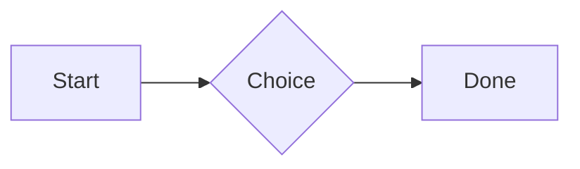

# Markdown sample

A showcase of every Markdown feature, for manual testing with `make run-sample`.
Some features are not rendered yet; see `doc/plan.md` for the roadmap.

## Headings

# Heading 1
## Heading 2
### Heading 3
#### Heading 4
##### Heading 5
###### Heading 6

Setext heading 1
================

Setext heading 2
----------------

## Paragraphs and line breaks

A paragraph that is long enough to wrap in a narrow preview window, so that the wrapping, hanging indent and source mapping can be checked by eye. It continues across several sentences.

A second paragraph.
A soft line break above, and a hard break with two spaces  
here, and with a backslash\
here.

## Inline formatting

*Emphasis*, _emphasis_, **strong**, __strong__, ***strong emphasis***,
~~strikethrough~~, `inline code`, ``code with a ` backtick``.

Escapes: \*not emphasis\*, \# not a heading, \[not a link\].

Entities: &copy; &amp; &lt;tag&gt; &#35; &#x1F600;

## Links

An [inline link](https://example.com), one [with a title](https://example.com "Title"),
a [reference link][ref], a [collapsed reference][], a [shortcut] reference,
an autolink <https://example.com>, a bare URL https://example.com and
an email <user@example.com>.

[ref]: https://example.com/ref "Reference title"
[collapsed reference]: https://example.com/collapsed
[shortcut]: https://example.com/shortcut

## Images


![Reference image][img]

[img]: https://example.com/ref.png

## Block quotes

> A quote with **inline** formatting.
> It continues on this line.
lazy continuation line
>
> > A nested quote.
>
> Back in the outer quote.

## Lists

Unordered:

- Item one
- Item two
  - Nested item
    - Deeper item
- Item three

* Star marker
+ Plus marker

Ordered:

1. First
2. Second
   1. Nested first
   2. Nested second
3. Third

Starting at a different number:

7. Seven
8. Eight

Loose list:

- Paragraph one

- Paragraph two

  Continued paragraph inside the item.

Task list:

- [x] Done
- [ ] Not done

List with a block inside:

1. Step with code:

   ```sh
   make test
   ```

2. Step with a quote:

   > Quoted in a list.

## Code

Indented code block:

    local x = 1
    print(x)

Fenced code block:

```
plain fence
```

Fenced with language:

```lua
local function hello(name)
  return "hello " .. name
end
```

Tilde fence:

~~~python
def hello():
    print("hello")
~~~

## Thematic breaks

---

***

___

## Tables

| Left | Center | Right |
|:-----|:------:|------:|
| a    |   b    |     c |
| long cell content | `code` | **bold** |
| pipe \| escaped | | empty neighbour |

## HTML

<div align="center">
  <b>An HTML block</b>
</div>

Inline HTML: <kbd>Ctrl</kbd>+<kbd>C</kbd> and <br> a break.

<!-- An HTML comment -->

## Footnotes

A sentence with a footnote.[^1] Another one.[^note]

[^1]: The first footnote.
[^note]: A named footnote
    with a continuation line.

## Mermaid



## Wide characters

日本語の段落です。全角文字は二つの桁を使います。 Emoji 😀 and accents: café, naïve.

## Long word

Supercalifragilisticexpialidocious_Supercalifragilisticexpialidocious_Supercalifragilisticexpialidocious
