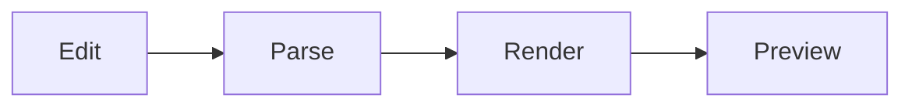
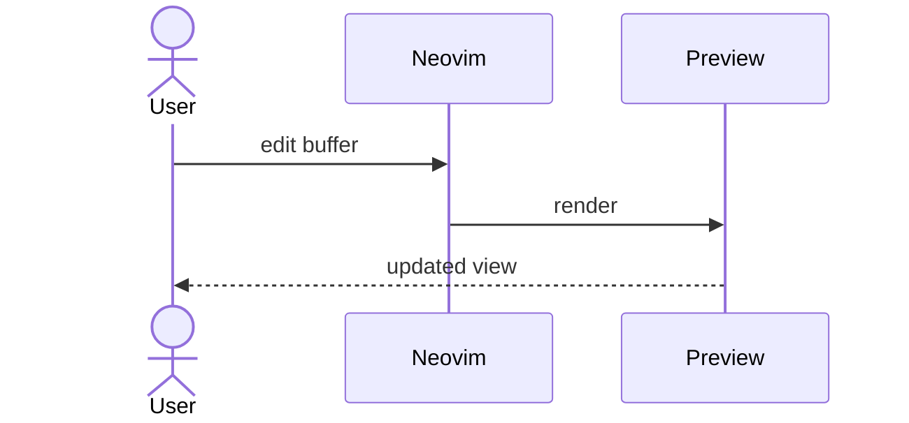

# Release notes preview

Write **Markdown** in one window and read the *rendered* result in
another. Diagrams, tables and `inline code` are drawn with plain text, so
everything works in any terminal. See the [project page](https://example.com)
for more.

## Highlights

- Live preview that follows your cursor and scroll position
- Three layouts: replace, vertical split, horizontal split
- Mermaid diagrams rendered as text

## Build pipeline



## Request flow



## Layouts

| Layout  | Preview window | Best for         |
|---------|----------------|------------------|
| replace | current window | focused reading  |
| vsplit  | on left        | wide screens     |
| hsplit  | below          | narrow terminals |

## Configuration

```lua
require("doc_preview").setup({
  layout = "vsplit",
  max_width = 100,
})
```

## Wrap-up

> Scroll either window and the other one follows.

That is all: toggle the preview off again with the same command.
