# Mermaid class diagram sample

Showcase of what the preview renders for `classDiagram` today, and what it
does not. Open with `:DocPreview`. Status is tracked in `doc/plan.md` and
`doc/diagram-model.md`.

## Supported

### Class with annotation, members and methods

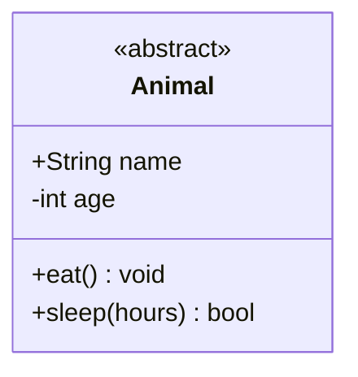

### All relation kinds

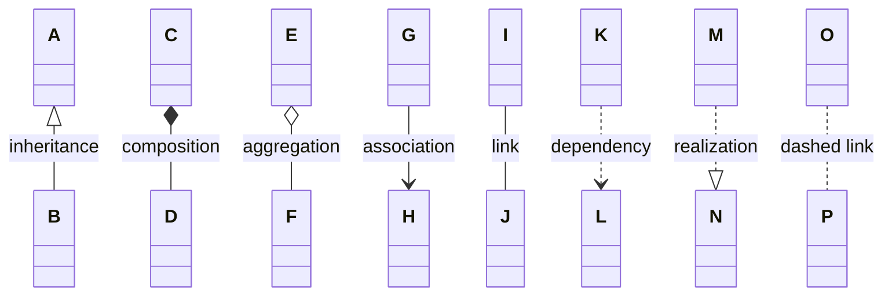

### Cardinalities and labels

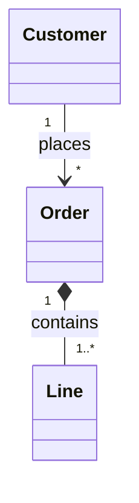

### Inheritance tree with members

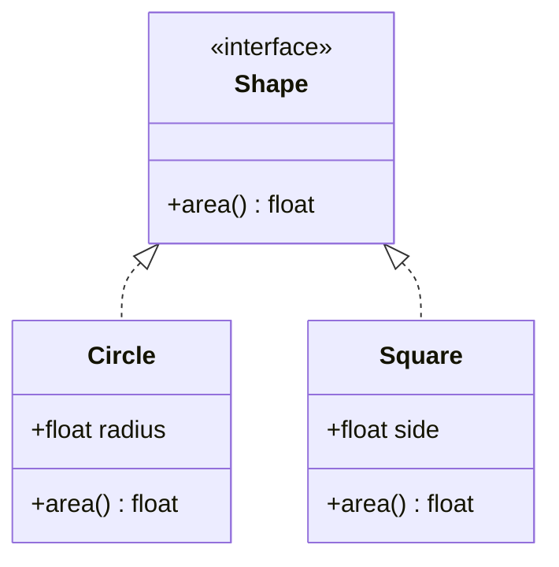

### Generics

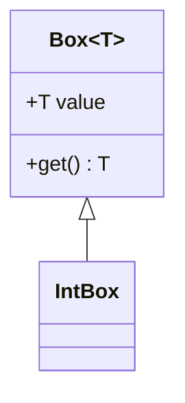

### Notes

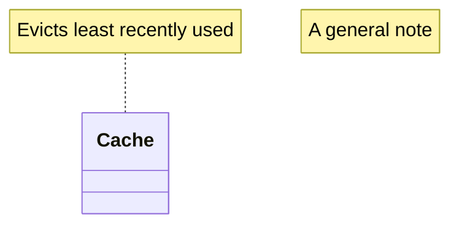

### Namespace (drawn as a cluster)

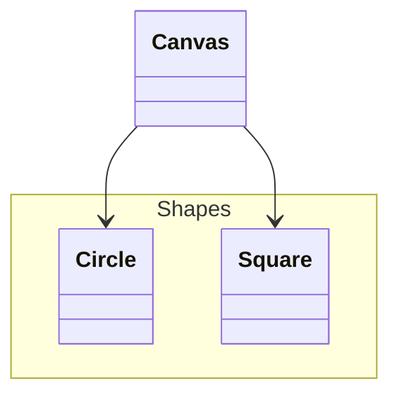

### Direction

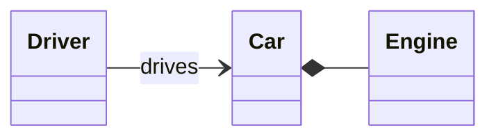

### Parse error shows the source

```mermaid
classDiagram
    class A {
        +broken(
    A <|-- 
```

### Wide diagram: width fallbacks

Resize the preview narrow: spacing goes compact, then top-down, then the
source is shown in a box.

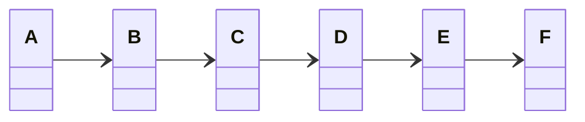

## Not implemented or approximated

### Nested namespaces (syntax error)

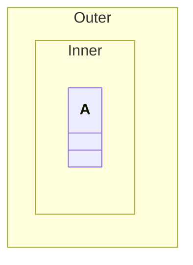

### One-line class body (syntax error)

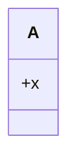

### Styling and links (parsed, ignored)

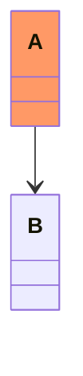

### Compact spacing loses connectors and cardinalities

Narrow the preview until the compact layout is used.

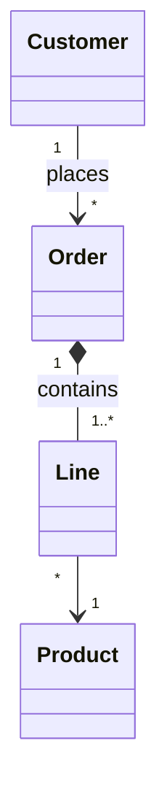

### ASCII: triangle and open arrow look the same

Set `charset = "ascii"` and compare.

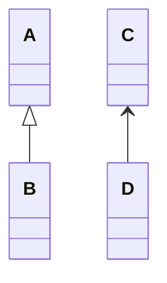
