# Mermaid flowchart sample

Showcase of what the preview renders for `flowchart` / `graph` today, and what
it does not. Open with `:DocPreview`. Status is tracked in `doc/plan.md` and
`doc/diagram-model.md`.

## Supported

### Directions

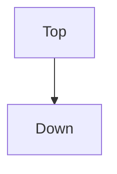

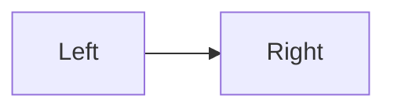

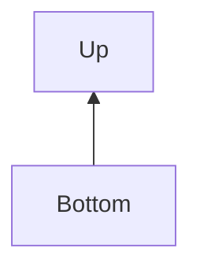

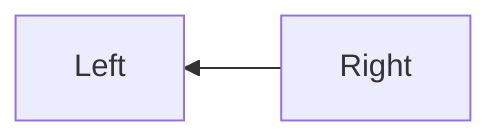

### Node shapes

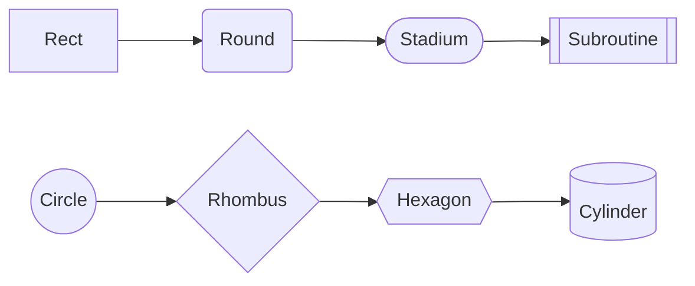

### Edge styles, heads and labels

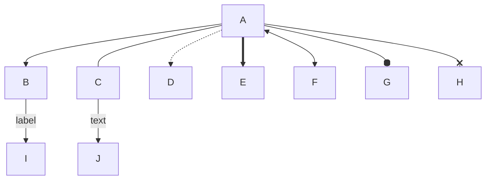

### Chains, fan-out and fan-in

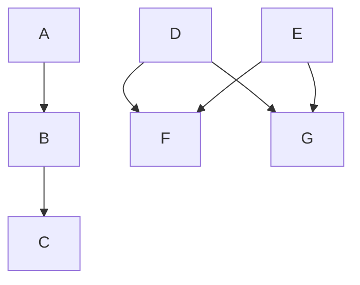

### Labels: quotes and line breaks

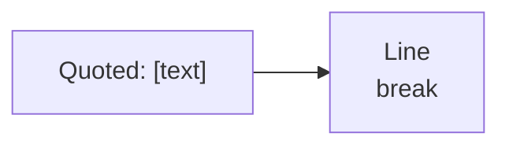

### Cycles and self-loops

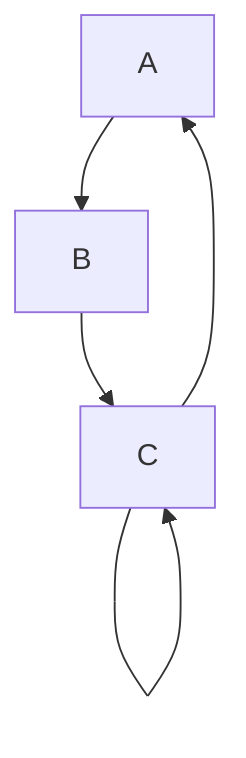

### Subgraphs, nested, with edges across the border

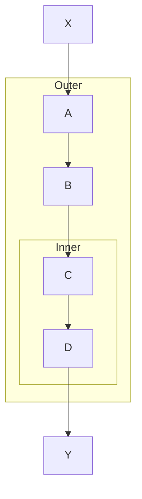

### Edge to a subgraph id

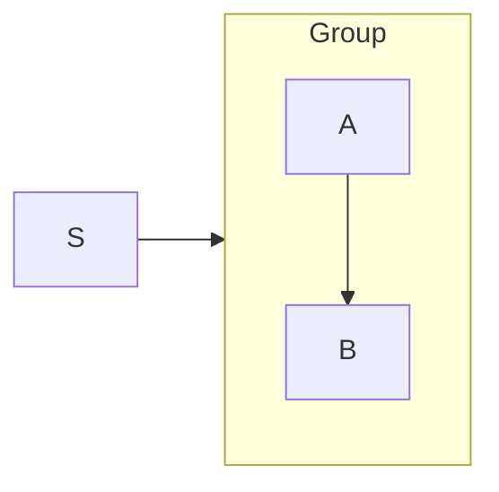

### Parse error shows the source

```mermaid
flowchart TD
    A[unclosed --> B
```

### Wide diagram: width fallbacks

Resize the preview narrow: spacing goes compact, LR turns top-down, and
when nothing fits the source is shown in a box.

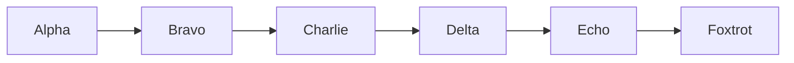

## Not implemented or approximated

### Asymmetric and trapezoid shapes (drawn as rect)

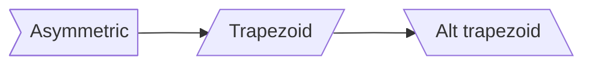

### Styling (parsed, ignored)

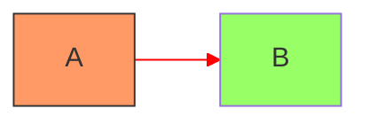

### Subgraph `direction` (ignored)

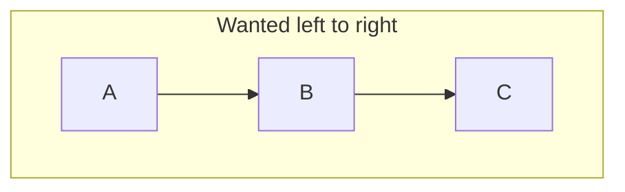

### Edge to a subgraph attaches to its first member, not the border

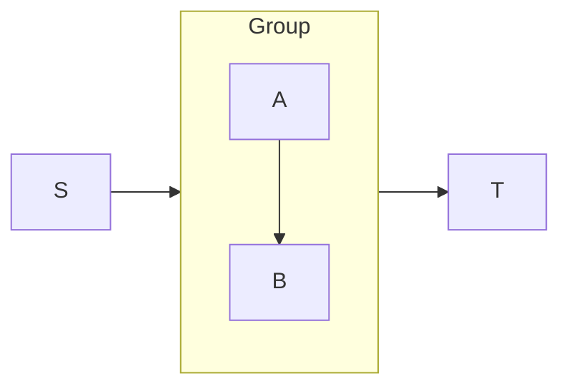

### Opposite edges overlap on one line

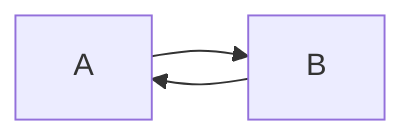

### Edge label dropped when no free cell is beside the line

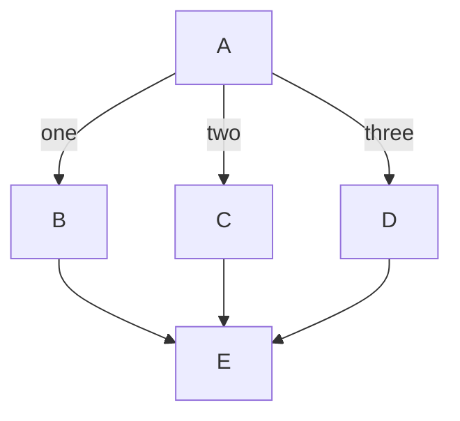

### Compact spacing loses vertical connectors

Narrow the preview until the compact layout is used.

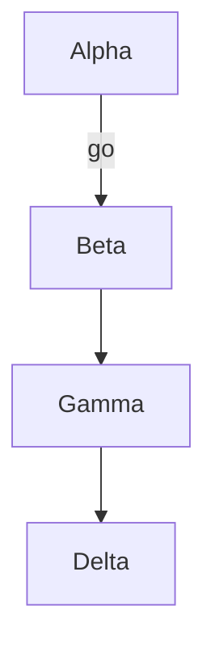

### Frontmatter config and `%%{init}%%` (skipped, no effect on drawing)

```mermaid
---
config:
  theme: dark
---
flowchart LR
    %%{init: {"theme": "forest"}}%%
    A --> B
```

### `@{ shape: ... }` node attributes (syntax error)

```mermaid
flowchart LR
    A@{ shape: cloud, label: "New shape syntax" } --> B
```
