# Mermaid sequence diagram sample

Showcase of what the preview renders for `sequenceDiagram` today, and what
it does not. Open with `:DocPreview`. Status is tracked in `doc/plan.md` and
`doc/diagram-model.md`.

## Supported

### Participants, actors and aliases

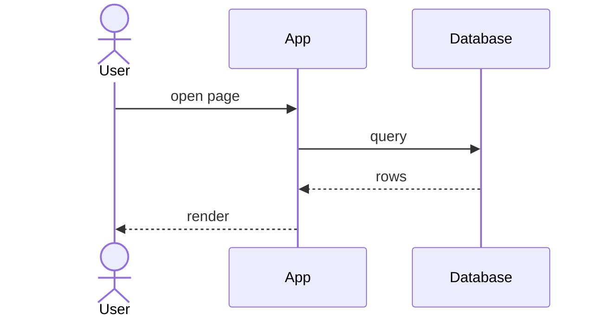

### All message operators

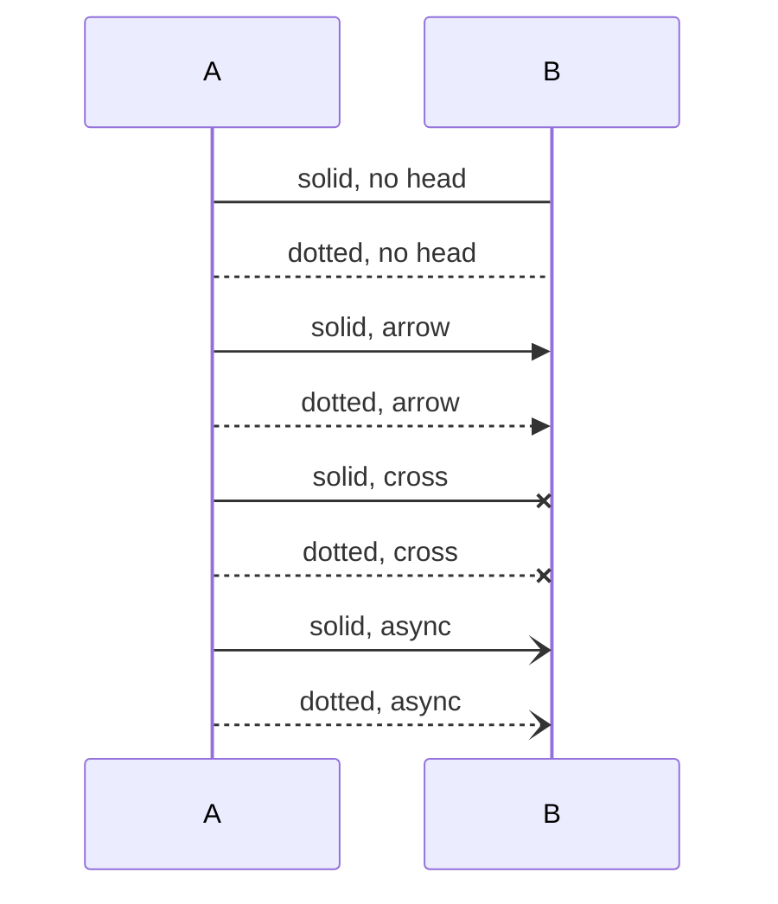

### Self message

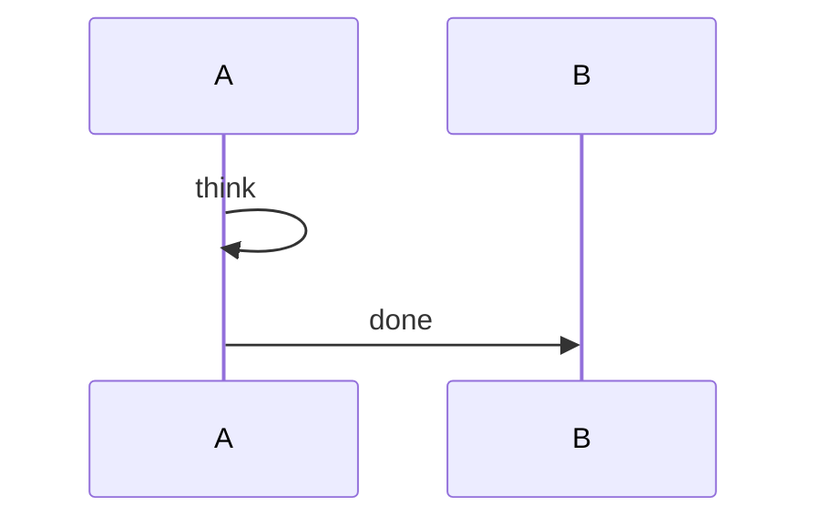

### Activation bars, explicit and shorthand

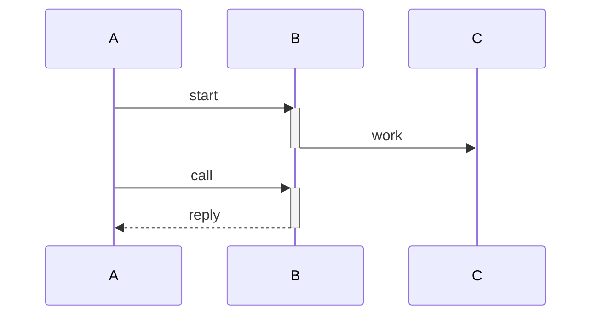

### Notes

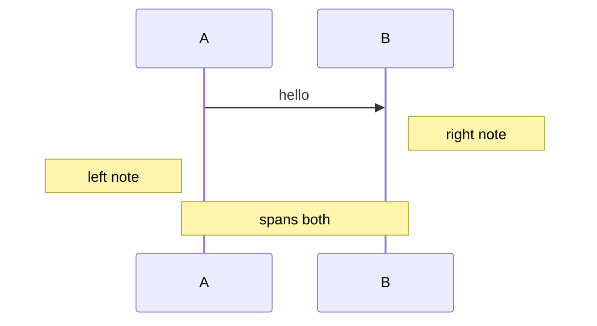

### Autonumber

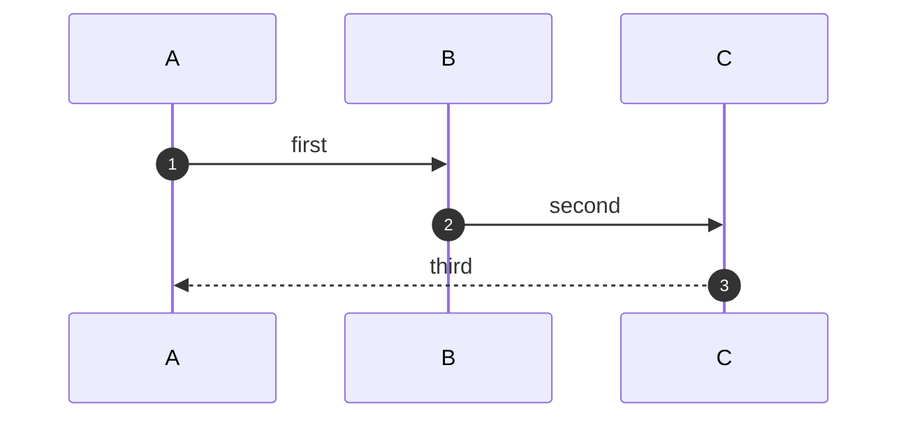

### Frames: loop, alt, opt, par, critical, break

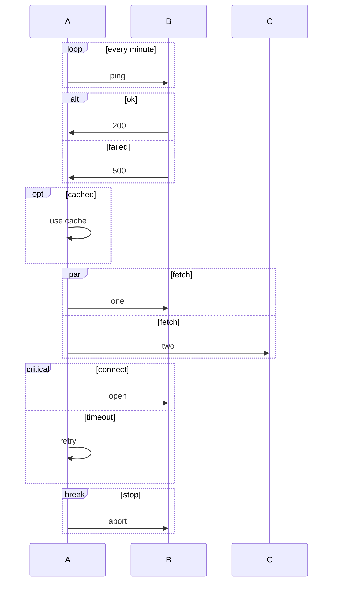

### Nested frames

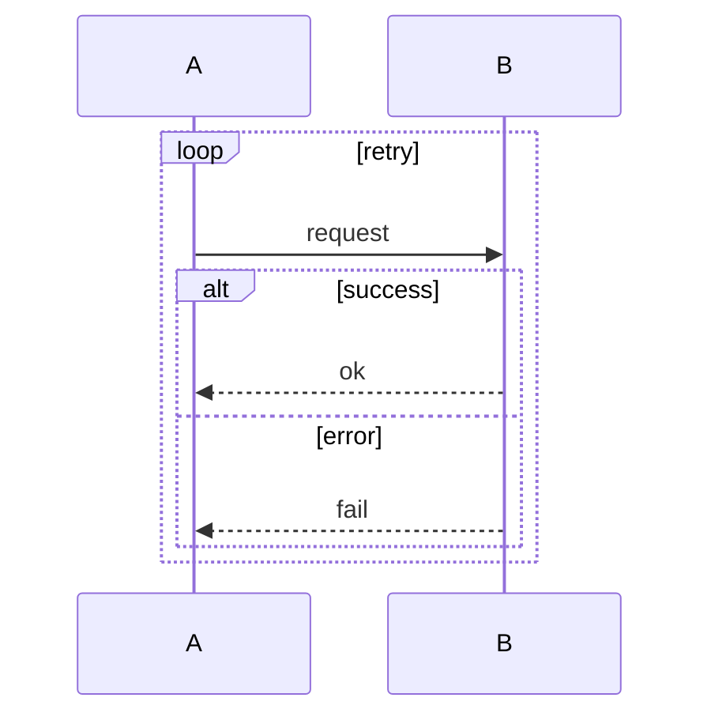

### `rect` blocks (transparent: events laid out, no frame)

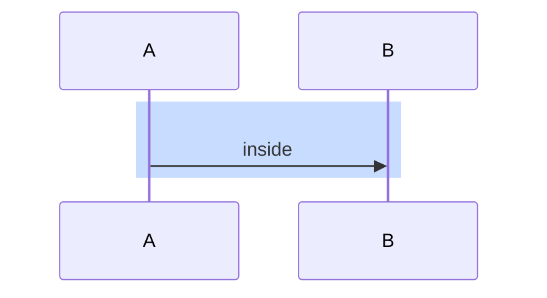

### Parse error shows the source

```mermaid
sequenceDiagram
    A->>B: ok
    end
```

### Wide diagram: width fallbacks

Resize the preview narrow: spacing goes compact, message text wraps, then
the source is shown in a box.

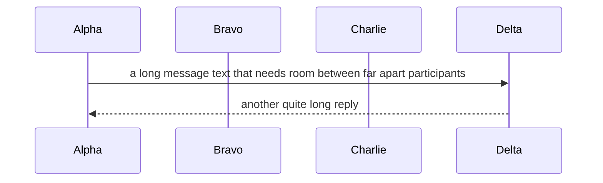

## Not implemented or approximated

### `box` grouping (kept balanced, not drawn)

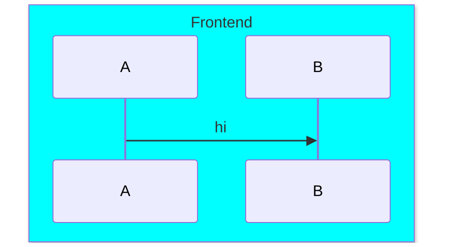

### Ignored statements

`title`, `link`, `links`, `properties`, `details`, `destroy` and the
accessibility lines parse but have no effect.

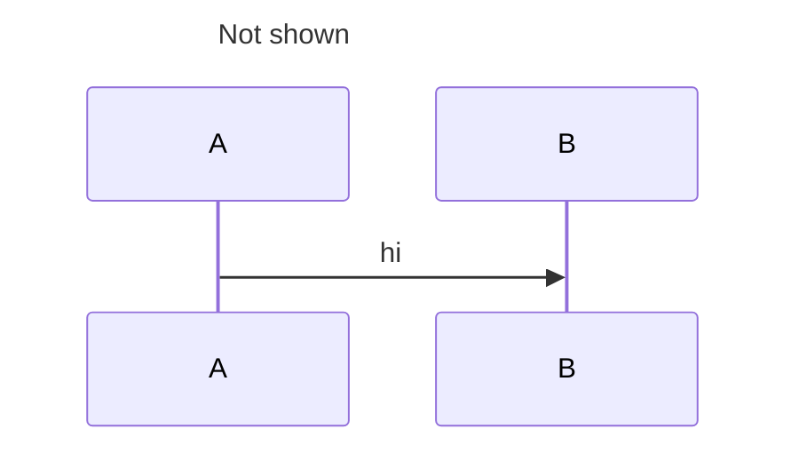

### Message without text (accepted, mermaid.js rejects it)

```mermaid
sequenceDiagram
    A->>B
```

### Frames always span the full diagram width

The frame covers participants it does not involve.

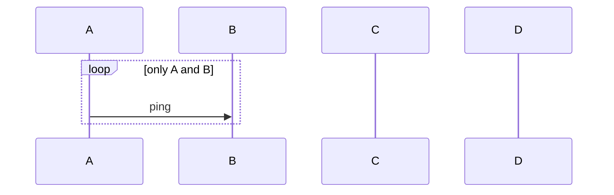

### Text across non-adjacent participants can overwrite a middle lifeline

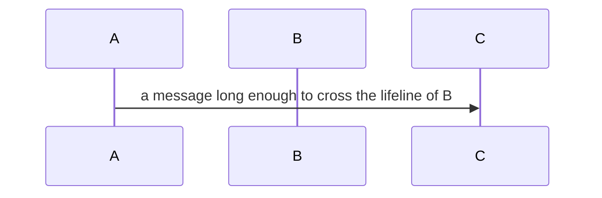
